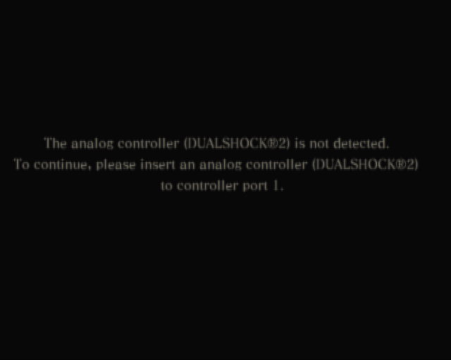
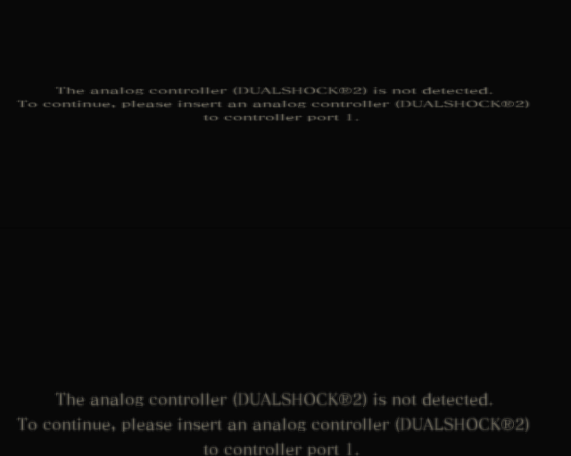

<div align="center">

# Drakengard 1 · Europe

### Static recompilation research for PlayStation 2

A source-only project working toward a native PC port of **Drakengard**.

[](https://github.com/k1gs/Drakengard1Recompile/actions/workflows/ci.yml?query=branch%3Amain)
[](LICENSE)


[Project site](https://dod1.keggs.ru) · [Telegram channel](https://t.me/dodrecomp)

[Progress](#progress) · [Getting started](#getting-started) · [Documentation](#documentation)

</div>

> **Research in progress. No playable build is available.**
> The native diagnostic runner reaches the **Chapter I mission briefing** after
> the main menu and narrative prologue, using ordinary controller input.
> In-world movement and combat are not yet verified.

## The project

The goal is to bring **Drakengard (PS2, Europe)** to PC through static recompilation,
with explicit runtime support for the hardware and services its original code uses.
Windows x64 is the initial host target. Linux portability is a later goal.

The observed input is **SLES-52322 · version 1.00 · PAL**. Exact ISO and ELF fingerprints
are recorded in local intake output; the serial alone does not establish
revision or dump authenticity. Game-specific bindings require the verified ELF hash.

## Progress

| Area | Verified milestone | Remaining work |
| --- | --- | --- |
| Input & toolchain | Read-only intake, pinned tools and local European ELF lift | Broader translation and runtime coverage |
| EE ↔ IOP | Guest-owned reboot, two actual BOOTEND stores and SIF transfers | Broader device and service coverage |
| Guest modules & input | Original IOP modules execute; SIO2 accepts ordinary button presses/releases and menu selections | Broader controller coverage and in-game validation |
| Disc services | 226 CDVD transfers and 5,997,856 bytes read from the verified ISO | Validate later disc operations |
| Graphics & gameplay | Rendered main menu, prologue and Chapter I mission briefing | Verify in-world movement and combat |
| Audio, saves & recovery | Validation matrix documented | Verify these in actual gameplay |

Passing CI validates preparation tools and synthetic service contracts.
It does **not** establish a working port. Detailed evidence and the current boundary
live in [IOP bootstrap notes](docs/IOP_BOOTSTRAP.md).

### Native screenshots

Actual guest GS output from the native diagnostic runner on Windows, not a host splash
or an emulator screenshot. The reviewed image shows the **New Game / Load Game / Options**
menu reached in run 240 at 640×511. Pixels retain their original brightness; no game-state
patches or menu mockups were used. This is menu evidence, not gameplay verification.

**Reviewed screenshot — main menu reached**



<details>
<summary>Earlier milestone — controller warning with duplicated scanout</summary>



</details>

## Getting started

The public checks need no game or BIOS. Install **Python 3.10+** and **Git**:

```powershell
python scripts/doctor.py
python -m unittest discover -s tests -v
python scripts/check_public_tree.py
```

Standalone C++ service checks additionally require **CMake 3.21+** and a **C++20 compiler**.
[CI](.github/workflows/ci.yml) runs synthetic checks on Windows and Linux.
This does not build or validate the private native game runner on Ubuntu.

To work with your own completed local input, follow the local runner instructions and keep
the original image outside the repository.
The fingerprint tool inspects inputs; it does not extract an ISO or establish authenticity.
The native runner is a diagnostic experiment and requires additional local preparation.

## Documentation

| Guide | What it covers |
| --- | --- |
| [IOP bootstrap](docs/IOP_BOOTSTRAP.md) | Guest execution evidence, strict device models and blockers |
| [SIF protocol](docs/SIF_PROTOCOL.md) | Packet, RPC and DMA coverage |
| [Media](docs/MEDIA.md) | Read-only ISO/CDVD services and checks |
| [Kernel patch](docs/KERNEL_PATCH.md) | Translation evidence and validation limits |

## Contributing

Focused work on device contracts, CPU behavior, synthetic tests and documentation is welcome.
For runtime reports, include the tool revision, input fingerprint, first blocker and a reproducible
procedure. Keep game data, BIOS, generated guest code, saves and raw traces out of issues and patches.

Unsupported behavior stops explicitly. Changes should demonstrate the real operation and its
failure cases before extending coverage. See the [project rules](AGENTS.md).

## Source-only & licensing

This repository distributes original project source, synthetic tests, configuration templates
and reviewed documentation, including two explicitly approved screenshots. It includes
**no game inputs, BIOS, original executables or generated game code**. Supply your own
local inputs; keep them in ignored directories.

Original project code and documentation are licensed under [MIT](LICENSE). No upstream runtime
or generated game code is vendored. Any future third-party integration needs its own license review.
Game imagery in documentation remains the property of its respective rights holders.

*Independent, unofficial research project. Not affiliated with the game's rights holders.*
